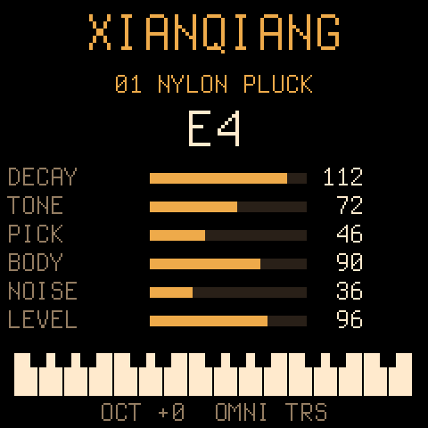

# 弦腔 XianQiang

M-VAVE FM-1 的物理建模固件。六复音，44.1 kHz，定点运算。屏幕上直接显示模型和旋钮名。



拨弦、木棒、钟、鼓膜、拉弦和吹管做在同一套引擎里，用预设切换。没有接上真机：声音用电脑上的同一套 DSP 渲染成 WAV，并用固件自带的主机模拟器把面板跑了一遍。可刷写的包在 `dist/xianqiang-0.1.fwsc`。

## 为什么基于 Dinghy

[Felucca](https://github.com/hugelton/Felucca) 的引擎表和插件接口都能加引擎，但它自己已经带了一套 PHYS（DaisySP 的模态、Karplus-Strong、弦，加上 Rings 的共鸣弦）。再往整台音序器、效果器和回归哈希里塞一个模型，等于维护一份完整分叉；插件 `.fep` 也要先刷好 Felucca，不是独立固件。

[Dinghy](https://github.com/zvenson/dinghy)（本树取自提交 `ea1b6bf`，2026-11-07）是同一族平台里专门用来换成自己的乐器的那一版：更新、USB 救援、USB-MIDI、TRS MIDI IN、USB 音频、按键、编码器和屏幕都已经接好，应用就是 `firmware/src/xianqiang.c`。闪存驱动同时认 Puya `0x856014` 和 UC25HQ80 `0xB36014`。DSP 写在 `dsp/`，是教科书算法的定点实现，没有移植 DaisySP 或 Rings 的代码。

`dsp/` 和 `host/` 为 MIT。链进 Dinghy 之后，整份固件按 GPL-3.0-only 发布。平台版权在 `LICENSING.md`。

## 模型和预设

六个模型，十四个预设。编码旋钮 **PRESETS** 循环预设，电平单独保留。

| 预设 | 屏幕名 | 模型 | 听感 |
| --- | --- | --- | --- |
| 01 | NYLON | 拨弦 | 尼龙弦，中等衰减，拨片在中间 |
| 02 | STEEL | 拨弦 | 钢弦，更亮、余音更长 |
| 03 | MUTE | 拨弦 | 闷音 |
| 04 | HARP | 拨弦 | 竖琴，很长，靠近琴码 |
| 05 | MARIMBA | 木棒 | 马林巴，泛音接近 1 : 4 : 9 |
| 06 | XYLO | 木棒 | 木琴，更短更亮 |
| 07 | BELL | 钟 | 钟，1、2、2.4、3、4.5 一类非谐和泛音 |
| 08 | CHIME | 钟 | 更暗的钟 |
| 09 | DRUM | 膜 | 短促的鼓 |
| 10 | FRAME | 膜 | 框鼓，稍长 |
| 11 | VIOLIN | 拉弦 | 持续的高音弦 |
| 12 | CELLO | 拉弦 | 更暗、更慢 |
| 13 | CLARINET | 吹管 | 单簧管：约四分之一波长，奇次谐波 |
| 14 | FLUTE | 吹管 | 长笛：开管，按音高锁定的气柱 |

拨弦是扩展 Karplus-Strong：噪声拨片、拨片位置梳状滤波、亮度在「原样」和经典平均滤波器之间混合，衰减是回路增益。木棒、钟、鼓膜各用五个衰减正弦模。拉弦和长笛是同一根按音高调好的延时线，每圈加一次弓毛或气柱脉冲；单簧管是带簧片饱和的波导。延时线长度 2048（2 的幂，循环里不做除法），最低可对准的音大约是 29 Hz（MIDI 22 附近再低会被夹住）。键盘在八度 −2 时从 F1 起，这个范围是准的。

复音 6。一条很亮的钟和弦会顶到限幅，正常拨弦和弦留有余量。

## 旋钮、按键、MIDI

FM-1 的七个编码器：

| 编码器 | 屏幕上的名字 | 作用 |
| --- | --- | --- |
| PRESETS | （顶行预设名） | 切换预设 |
| SELECT | DECAY | 衰减。拨弦和模态是余音，拉弦和吹管是松开后的阻尼 |
| ALGORITHM | TONE 或 BRIGHT | 亮度 |
| KNOB1 | PICK / STRIKE / PLACE | 拨片、敲击点或弓/气口位置 |
| KNOB2 | BODY / STIFF / PRESS / REED | 拨弦的梳状深度、模态的刚度、弓压或簧片 |
| KNOB3 | NOISE / SPEED / BREATH | 拨弦噪声、运弓或气息 |
| KNOB4 | LEVEL | 引擎电平 |

MASTER 旋钮是平台的总音量，不进这六个参数。参数名随模型变，数值 0–127 写在条的右边。

| 按键 | 作用 |
| --- | --- |
| OCT− / OCT+ | 八度 −2…+2，写入闪存 |
| SEL | MIDI 通道：OMNI，然后 1…16，再回到 OMNI |
| ENV | 本机延音锁，灯亮表示按住 |
| HOME | 立刻静音 |

FM-1 的 27 键没有力度，固件用 108。SMK-37 用琴键力度、外侧键、打击垫和弯音轮。通道和八度、预设、六个参数、延音锁在声音停掉大约两秒后写入闪存。擦除会停声音几十毫秒，所以响着的时候不写。

USB-MIDI 和 TRS MIDI IN 进同一个队列。状态行在有输入时显示 `USB` 或 `TRS`。本机构建不含 BLE MIDI。

| MIDI | 作用 |
| --- | --- |
| 音符开/关、力度 | 演奏 |
| 弯音轮 | 大约 ±2 半音 |
| CC 1 | 颤音深度，大约 4.7 Hz，最深约 ±25 音分 |
| CC 7、CC 26 | 电平 |
| CC 11 | 表情，额外增益 |
| CC 21 / 72 | 衰减 |
| CC 22 / 74 | 亮度 |
| CC 23 | 位置 |
| CC 24 / 71 | 色彩（BODY / STIFF / PRESS / REED） |
| CC 25 / 73 | 激励 |
| CC 64 ≥ 64 | 延音踏板 |
| CC 120 | 立刻静音 |
| CC 123 | 松开全部键；踏板还踩着时继续响 |

时钟、开始和停止会在状态行显示速度，PLAY 灯在拍点上闪一下。

## 在电脑上听

不需要工具链，也不需要 FM-1。

```sh
sh host/run_tests.sh          # 定点引擎的回归测试，有 ASan/UBSan 时再跑一遍
sh tests/run_host.sh          # 同一份 xianqiang.c：WAV + 240×240 屏幕
```

`host/run_tests.sh` 会写出：

| 文件 | 内容 |
| --- | --- |
| `demos/nylon-steel.wav` | 尼龙弦琶音，接到钢弦 |
| `demos/marimba.wav` | 马林巴 / 木琴 |
| `demos/bell.wav` | 钟 |
| `demos/bow-reed.wav` | 小提琴、大提琴、单簧管、长笛 |

测试核对的是：没按键时是静音；钢弦 A4/A3/A5 的周期落在采样点上（A4 为 100 点，440 Hz）；闷音比竖琴灭得快；亮度提高高频；拨片位置会改波形；钟比鼓长，马林巴 C5 对准音高；拉弦按住时持续、松开后下降，音高仍是弦的音高；单簧管和长笛音高不同且都接近 A4；六音同时不出 ±32767；弯音往上会缩短周期；两次渲染逐样本一致；电平旋钮改变响度。钟的泛音本来就不谐和，自相关得到的周期允许偏离基频几个采样点。

`tests/run_host.sh` 用 Dinghy 的假面板跑按键、编码器和 MIDI，屏幕图在 `build/host/xianqiang-*.png`。`BOARD=smk37 sh tests/run_host.sh` 跑 SMK-37 的力度、打击垫和弯音轮。

音高表由 `tools/gen_pm_tables.py` 生成到 `dsp/pm_tables.h`（44100 Hz，A4 = 440）。引擎里没有浮点类型，也没有 64 位除法。

## 编译固件

需要 x86-64 Linux（macOS 上 Dinghy 的脚本会自己用 Docker）、Python 3 和 Pillow。

```sh
pip3 install Pillow mido python-rtmidi
tools/get_toolchain.sh
# 或取固定包并核对 SHA-256
# f686586bcfb45e0f0bb27fd2b39c7a7f313cb4f0e88a66a14da621ffa8225958
# https://jl-update.oss-cn-shenzhen.aliyuncs.com/jieli-linux-toolchains-20250324.1.tar.xz
# 解压到 ~/.jieli ，并把 toolchain 指到 jieli-linux-toolchains-20250324.1

git clone --depth 1 --branch AC79NN_SDK_V1.2.1_2023-12-13 \
    https://gitee.com/Jieli-Tech/fw-AC79_AIoT_SDK.git ~/fw-AC79_AIoT_SDK
```

SDK 里打进安装包的三个文件，标签 `AC79NN_SDK_V1.2.1_2023-12-13`：

| 文件 | SHA-256 |
| --- | --- |
| `cpu/wl82/tools/uboot.boot` | `4e3b4c220dc96641cb5a723f41e68ce41d5261ae9434bb33fbd7f2c59976ded4` |
| `cpu/wl82/tools/cfg_tool.bin` | `276579954f076886a6a7694f65dc71c034a63a2c204b76749065c0ac7b010d1b` |
| `cpu/wl82/tools/cfg/eq_cfg_hw.bin` | `41167491bffed4651750719c973d2758adeb9021a5670d02d6a53c85ed80ea7d` |

```sh
./build.sh                    # build/xianqiang.fwsc ，身份 FM-1_940
./build.sh --release 0.1      # build/xianqiang-0.1.fwsc ，身份 FM-1_941
BOARD=smk37 ./build.sh        # SMK-37 Pro，身份 SMK-37 Pro_940
```

`JIELI_TOOLCHAIN` 和 `AC79_SDK` 可以指向别的目录。构建会拒绝：镜像超出应用区、`.data+.bss` 超过 96 KB、池超过 336 KB、`.ram_text` 里出现调用、`hal/` 以外访问寄存器。链接结果里不应出现 `__udivdi3` 或软浮点符号。

这次在 x86-64 上编过。应用约 62 KB（槽位约 568 KB），`.data+.bss` 约 16 KB / 96 KB，池约 70 KB / 336 KB（六条 2048 点延时线加一块 240×96 的画布）。`dist/xianqiang-0.1.fwsc` 是同一次发布构建，身份 `FM-1_941`，SHA-256 见 `dist/SHA256SUMS`。包里含有上面三个 Apache-2.0 的 SDK 二进制，所以体积大约 600 KB。

JieLi 的 clang 是 Linux x86-64。`pkgman.jieliapp.com` 在有的网络上会按地区拒绝连接，那时用上面的阿里云地址，核对哈希再解压。不要为了下到文件关掉证书检查。

## 刷写之前：备份整片 1 MiB

FM-1 是单份固件，没有 A/B 区。先做完整备份。

1. 安装 [M-Flasher](https://github.com/jvitkauskas/m-flasher)（Windows、macOS、Linux）。用数据线直连，不要经过无电源的集线器。
2. 机器开着、固件还在跑时，点 **DOWNLOAD MODE**。它通过 USB-MIDI 发送 `F0 22 24 35 7D F7`，官方固件和 Felucca 会进下载模式。弦腔走 Dinghy 的更新协议，Firmware Hub 和下面的命令行安装器可以再刷；若这台机器不吃这条 SysEx，用后面的 USB_KEY。
3. 屏幕会停在进入前的画面。电脑上出现名为 `WL82 UBOOT1.00` 的空磁盘。不要初始化、不要格式化。
4. 在 M-Flasher 里选 **备份整片闪存**。得到 1 MiB 的 `.bin` 和一份 `.json`。两边都留着，最好复制到另一块磁盘。这一步不改闪存。
5. 备份结束之后再拔线，关机再开机，确认原来的固件还在，然后再装新固件。

恢复这份备份时，M-Flasher 会按差异写回，并保留本机自己的校准和蓝牙地址。不要把别人机器的备份整片写到这台机器上。

## 刷写

浏览器要用 Chrome 或 Edge（Web MIDI，而且要允许 SysEx）。命令行：

```sh
python3 tools/fm1_install.py dist/xianqiang-0.1.fwsc
python3 tools/fm1_install.py --info
```

安装器会先问再写，写的是应用区和它自带的更新加载器，不写 `0x0000`–`0x3FFF` 的引导区。写到一半断电有风险，见下面的恢复。装上去之后可以用同一个安装器或 Firmware Hub 换回别的包。

包身份是 `FM-1_94N`（0.1 版为 `FM-1_941`）。`900` SLOOP、`91N` Felucca、`93N` sloopDX、`97N` zp12、`98N` 一个 Doom 移植、`99N` Dinghy 已经占用。公开挂到 Firmware Hub 之前，先对一下当时的列表，避免两份固件用同一个身份。

若机器上跑的是 M-VAVE 的 FM1 Open，不少安装器会拒绝。先按下一节回到官方 V15，再装弦腔。

## 回到官方 V15 / V16

官方下载地址从 2026-10 起提供的是 V16，不再是 V15。只认 V15 哈希的工具会拒绝今天的官方文件。

- **V15**：[m-vave/fm1_open](https://github.com/m-vave/fm1_open) 的 `sdk/firmware/FM-1_015.fwsc`（提交 `b178ac4`）。SHA-256：`db1642b2b6fa5c2cccb11ffd13878068bb28601678d3644049f99dc40e7edb8a`。用之前自己算一遍。
- **V16**：用 M-VAVE 当前提供的官方 `.fwsc`。M-Flasher 0.5 起能装 FM-1 016，包括它的设置布局。同样先核对文件哈希，再装。

用 M-Flasher 的「安装固件」选官方 `.fwsc`。需要连引导区一起回到出厂状态时，用它的「放回原厂引导」，并且只用官方包里的引导，不要用别的工程编的引导。装完关机再开机。

弦腔还在跑、USB 还在时，也可以直接 `python3 tools/fm1_install.py` 指向官方包，只要那个包带社区安装器认识的加载器标记。不认识就改用 M-Flasher。

## 闪存型号

两颗都是 1 MiB SPI NOR，命令集一样，身份不一样：

| 颗粒 | JEDEC |
| --- | --- |
| 早期 Puya P25Q80H | `0x856014` |
| 较新的 UC25HQ80 | `0xB36014` |

只认旧 ID 的固件能出声，但设置只留在 RAM 里，关机就没了，而且常常不能再次更新。弦腔沿用 Dinghy 0.5 的 `FL_JEDEC_OK`，两颗都允许保存和再次更新。

不要在 UC25HQ80 上安装 m-bootloader。M-Flasher 的说明里写过：这颗颗粒还没测过，已有一台装完无法启动，原因不明。保存设置和以后换固件，用认这两颗 ID 的应用固件即可，引导区保持原样。

应用大约住在 `0x4000`–`0x93000`。`0x0000`–`0x3FFF` 是引导，更新加载器拒绝写它。设置在 `0xFC000`，预设块在 `0xF4000` 起。这是单区闪存，没有第二份固件可回退，所以备份不能省。

## 变砖了怎么回来

按这个顺序，前一条能用就不要做下一条。

1. **开机时按住 OCT−**。Dinghy 的 USB 救援：没有声音，安装器还能用。启动过程中崩溃两次，也会自己进这里。
2. **下载模式**。固件还能响应时，用 M-Flasher 的 DOWNLOAD MODE。屏幕停住，系统里是 `WL82 UBOOT1.00`。不要格式化这只磁盘。然后备份（如果还没有），再安装官方包或上一份好的 `.fwsc`。
3. **USB_KEY**。USB 上什么都没有时，掩膜 ROM 仍会在上电时听数据线。FM-1 Transporter 用 Seeed XIAO RP2040（或 Pico 一类的 RP2040）：只接 D+、D−、GND，不接 VBUS，机器用自己的电池。ROM 要的是 16 位字 `0x16EF`。芯片拉低应答之后，把线改插到电脑，再用 M-Flasher 或 Transporter 读写。这步在引导区本身坏掉时仍然有效，因为听这个字的是 ROM，不是闪存里的引导。
4. 写回时沿用这些工具已经在真机上核对过的规则：先读完整片；芯片密钥应为 `0x980F`；只擦写 `[0x4000, 0x93000)` 里有差异的 4 KB 扇区，每扇区写完读回；`0x4000` 以下和 `0x93000` 以上的本机数据不动；最后整片再读一遍比对。较旧的 `fm1_rescue` 只接受 `0x856014`。UC25HQ80（`0xB36014`）用当前的 M-Flasher，它会报出读到的 JEDEC，而不是把新颗粒当成「没有闪存」。

参考：[FM-1 开发维基的 Recovery](https://sbegueria.github.io/fm1-dev-wiki/Recovery.html)、[M-Flasher](https://github.com/jvitkauskas/m-flasher)、[FM-1 Transporter](https://github.com/kurogedelic/FM-1-transporter)。

## 这次核对过什么

在这台 x86-64 机器上：

- `sh host/run_tests.sh`：功能测试和 ASan/UBSan 都通过。
- `sh tests/run_tests.sh`：主机面板、闪存允许列表、更新加载器不碰 `0x0000`–`0x3FFF`、安装器协议，全部通过。
- `./build.sh --release 0.1` 和 `BOARD=smk37 ./build.sh` 链接成功，构建脚本自己的检查通过。反汇编里没有 `__udivdi3` 和软浮点符号。
- 主机模拟器画出了上面的面板，并写出了带 MIDI 输出的 WAV。

没有 FM-1 在手上，所以下面这些没有在硬件上做过：实际刷写、耳机输出、USB 音频是否无爆音、pi32v2 上这一块的周期数、UC25HQ80 的实机保存、BLE（本固件本来就没有 BLE）。Dinghy 0.5 的平台作者记录过 USB 音频、按键、屏幕和从 Hub 刷回；弦腔的应用层没有在机器上跑过。若声音断裂，先把 `dsp/pm.h` 里的 `PM_VOICES` 从 6 降到 4 再编，模态那一路最吃周期。

拉弦是「每圈一个脉冲的波导」，用来把音高锁在延时线上，不是完整的粘-滑弓模型。单簧管是簧片饱和加半周期延时。两者在测试里音高和持续是对的，音色比一架研究用的物理模型简单。
